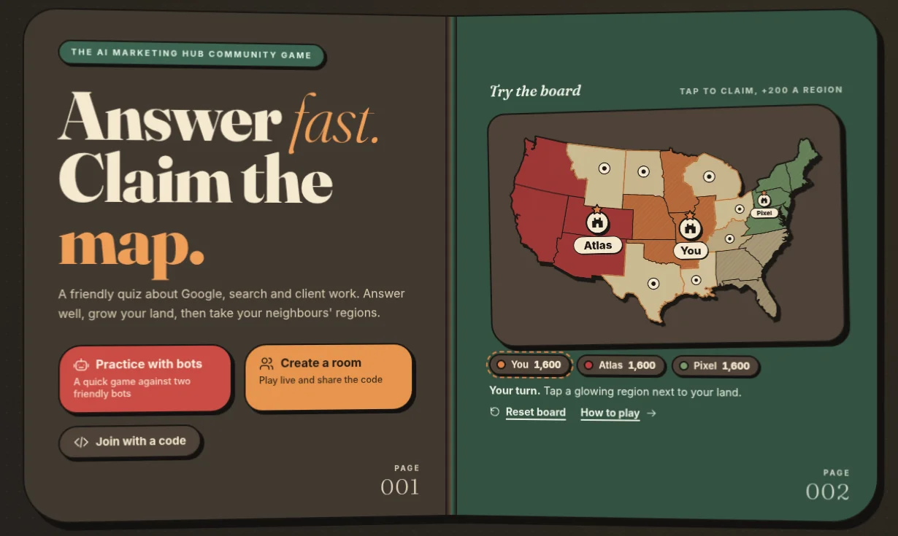
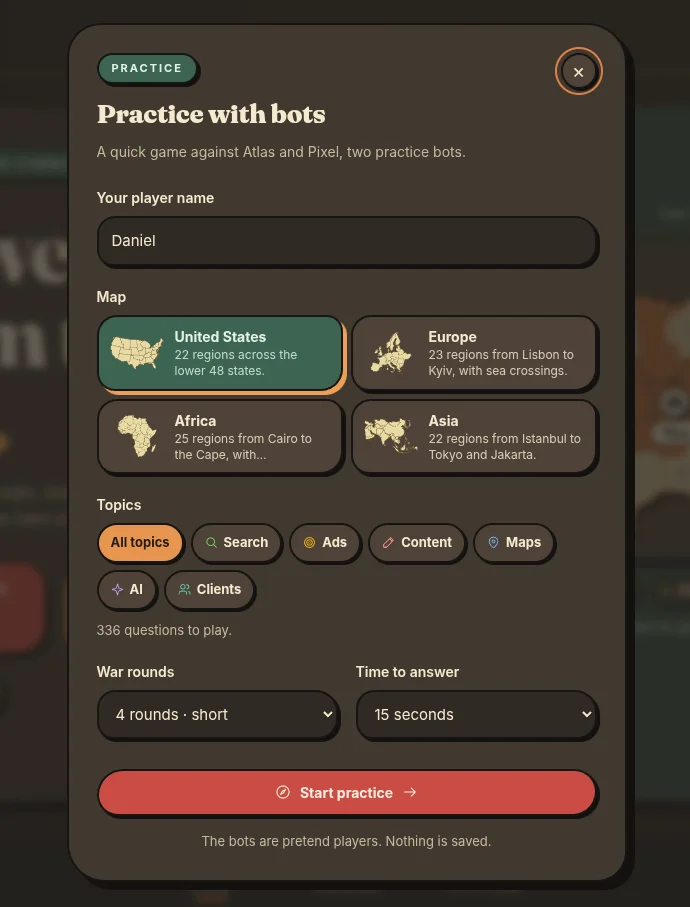
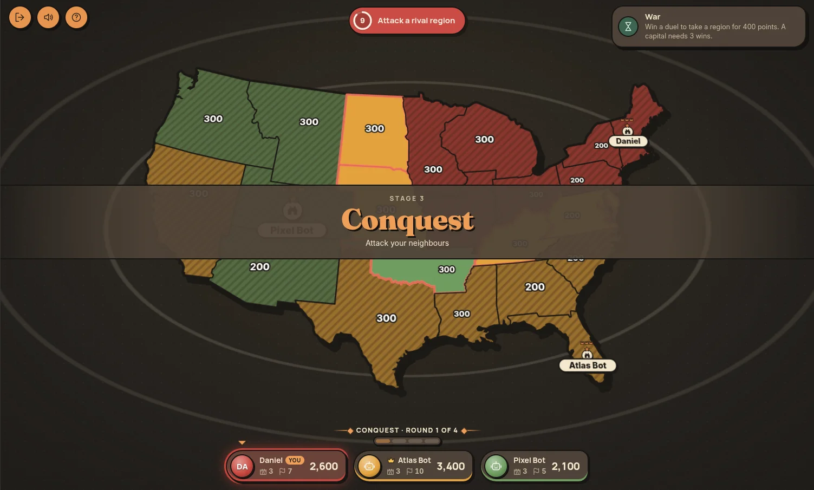
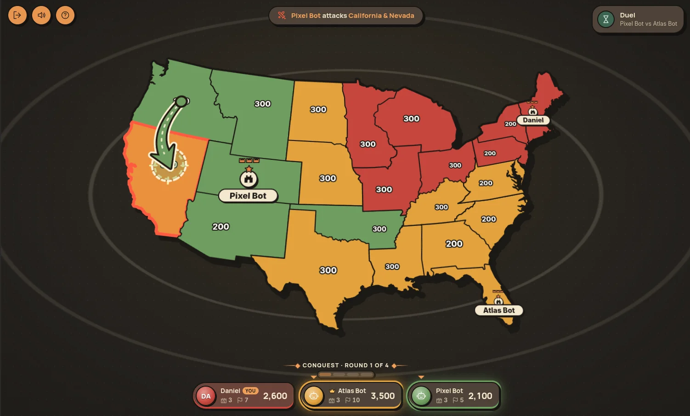
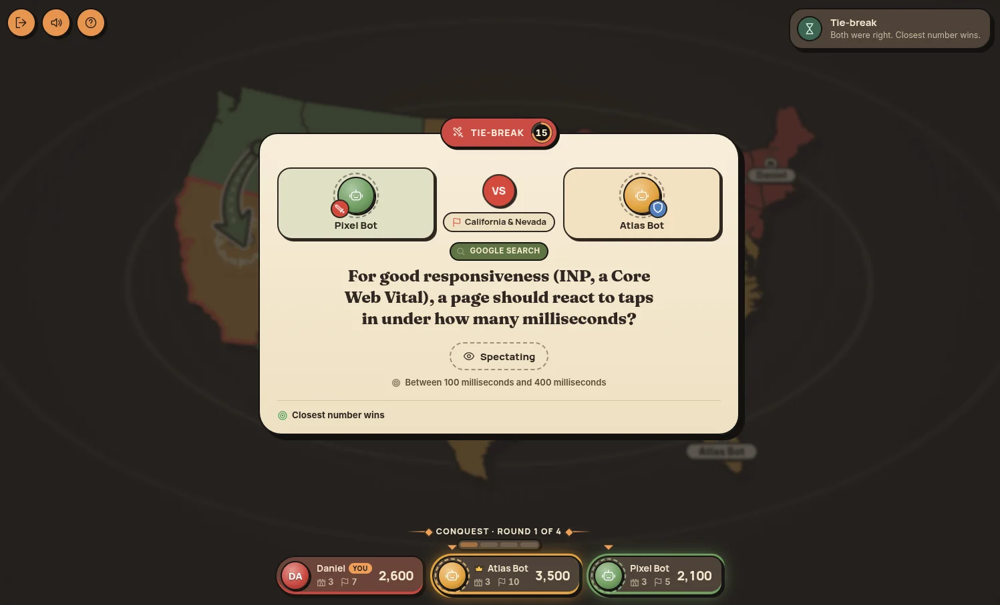

# Keywordia

**Answer fast. Claim the map.**

Keywordia is a free multiplayer quiz game for marketers, made by the [AI Marketing Hub](https://github.com/AI-Marketing-Hub) community. Host a room, share the code, answer friendly questions about Google, search and client work, and use your answers to build a capital, grow your land and take your neighbours' regions.

No accounts, no ads, no tracking. One small Node.js server and a browser.



## Watch the video

[](https://www.youtube.com/watch?v=KuIN7EPK7tI)

Click the image to [watch it on YouTube](https://www.youtube.com/watch?v=KuIN7EPK7tI).

## Features



- **Play together or alone.** Create a private room for 2 to 6 players and share a six-character code, or practise against two friendly bots.
- **336 questions in six topics**, each with an explanation and a link to the official source behind the answer.
- **Four real maps:** United States, Europe, Africa and Asia.
- **Fair by design.** The server owns the game, keeps the answers hidden until everyone has locked in, and computes every score.
- **Made for any screen**, with keyboard controls (1 to 4 to answer), a number keypad, light and dark themes, sound and reduced-motion support.
- **Rejoin after a drop.** A disconnected player keeps their seat and can reconnect; if the host leaves, another player takes over.

<br clear="right">

## How a game works

1. **Capitals.** Each player founds a capital on the map. A capital has 3 towers and is worth 1,000 points.
2. **Expansion.** Everyone answers the same question. The fastest correct answer claims two free regions, the runner up claims one. On "closest guess" number questions, the closest answer wins. This repeats until the map is full.
3. **War.** For 4, 6 or 8 rounds, players take turns attacking a rival region on their border. Only the attacker and the defender answer. Win the duel and the region is yours. If both are right, a number question breaks the tie.
4. **Sieges.** Attack a capital and every duel you win knocks down a tower. Take the third tower and you take all of that player's land.
5. **Podium.** The most valuable territory wins. You get a stats table, a rematch button and a CSV export.

Your score is always the value of the regions you hold plus a bonus for each successful defence. [The protocol](docs/protocol.md) has the exact rules, timers and point values.



<table>
  <tr>
    <td width="50%"></td>
    <td width="50%"></td>
  </tr>
  <tr>
    <td align="center"><sub>Attack a region on your border</sub></td>
    <td align="center"><sub>Both right? The closest number wins</sub></td>
  </tr>
</table>

## Topics

Every topic has 50 multiple-choice questions and 6 "closest guess" number questions, written in plain English for marketers, freelancers, small agencies and business owners.

| Topic | What it covers |
| --- | --- |
| Google Search | What Google expects from a good page, helpful content, titles and snippets |
| Google Ads | Ad formats, targeting basics and ad policy |
| Content & YouTube | Helpful blog posts, YouTube and Shorts basics |
| Google Maps & Reviews | Business Profiles, reviews and showing up on Maps |
| AI Tools | Using AI tools for marketing work safely and well |
| Clients & Agency | Account access, client trust and honest promises |

Each answer is backed by a public primary source, mostly official Google and YouTube help pages. [Content sources](docs/content-sources.md) lists every source with a short quote. Sources were last checked in October 2026, and platform rules change, so corrections are welcome.

## Run it locally

You need [Node.js](https://nodejs.org) 22 or later.

```sh
git clone https://github.com/AI-Marketing-Hub/keywordia.git
cd keywordia
npm ci
npm start
```

Open <http://127.0.0.1:4317> and choose **Practice with bots** for a quick game. To try multiplayer on one computer, create a room in one tab and join it with the code from a second tab.

`npm run dev` restarts the server when you change server files.

## Configuration

Keywordia reads these environment variables. None are required to play locally.

| Variable | Default | What it does |
| --- | --- | --- |
| `HOST` | `127.0.0.1` | Interface to listen on. Use `0.0.0.0` to accept connections from other devices. |
| `PORT` | `4317` | Port to listen on. |
| `ACCESS_PASSWORD` | not set | When set, players must enter this password before they can play. |
| `TRUST_PROXY` | not set | Set to `1` behind a reverse proxy so rate limits see the real client address. |

## Hosting it for your group

A `Dockerfile` and a `railway.json` are included.

```sh
docker build -t keywordia .
docker run -p 4317:4317 -e ACCESS_PASSWORD=choose-one keywordia
```

Before you share a public link, keep in mind:

- **Rooms live in memory.** Restarting the server ends every game in progress. Empty rooms close after 30 minutes and every room closes after six hours.
- **Room codes are invitations, not security.** Set `ACCESS_PASSWORD` and serve the game over HTTPS if you don't want strangers joining.
- **It is built for friendly games.** Network speed affects who answers first, so this is not a cheat-proof competition platform.
- The server allows up to 200 rooms. That is a configured cap, not a tested load figure.

## Add or edit questions

Questions live in `data/questions.json` (multiple choice) and `data/estimates.json` (number questions). A multiple-choice question looks like this:

```json
{
  "id": "seo-11",
  "category": "seo",
  "difficulty": "Applied",
  "prompt": "Your question?",
  "options": ["One", "Two", "Three", "Four"],
  "correctIndex": 1,
  "explanation": "Why the second option is correct.",
  "source": { "title": "Primary source title", "url": "https://example.com/source" }
}
```

Number questions use `value`, `unit`, `min` and `max` instead of `options`. After editing, add the source to [content sources](docs/content-sources.md), run `npm run check`, and restart the server.

## Tests

```sh
npm run check   # syntax, question structure and source coverage
npm test        # game engine plus real HTTP and Socket.IO clients
```

## Project layout

| Path | What's inside |
| --- | --- |
| `src/game.js` | The game engine: rooms, phases, timers, bots and scoring |
| `src/server.js` | HTTP server, password gate, security headers and Socket.IO |
| `public/` | The browser app, map renderer, maps and fonts |
| `data/` | Questions, number questions and topics |
| `scripts/` | Content validator and the map builder |
| `tests/` | Engine and integration tests |
| `docs/` | Protocol and content sources |

## Credits

- Map borders come from [Natural Earth](https://www.naturalearthdata.com), which is in the public domain. Region groupings, board art and fortress drawings are original.
- Fonts: [Fraunces](https://github.com/undercasetype/Fraunces), [Inter](https://github.com/rsms/inter) and [Manrope](https://github.com/sharanda/manrope), under the SIL Open Font License (see `public/fonts/`).
- Built with [Socket.IO](https://socket.io).
- The game format is inspired by territory quiz games. All code, art and questions in this repository are original.

## License

- **Code:** [GNU AGPL v3.0](LICENSE). You can use, change and host Keywordia freely. If you run a modified version for other people, you must share your source code under the same license.
- **Questions and explanations:** [CC BY-NC-SA 4.0](LICENSE-CONTENT.md). Reuse them for non-commercial projects with credit to the AI Marketing Hub, and share your changes under the same license.
